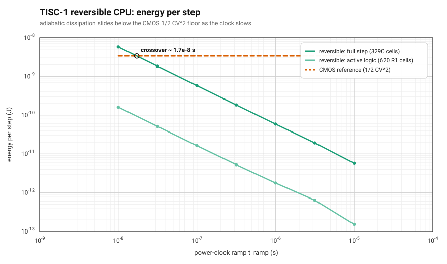
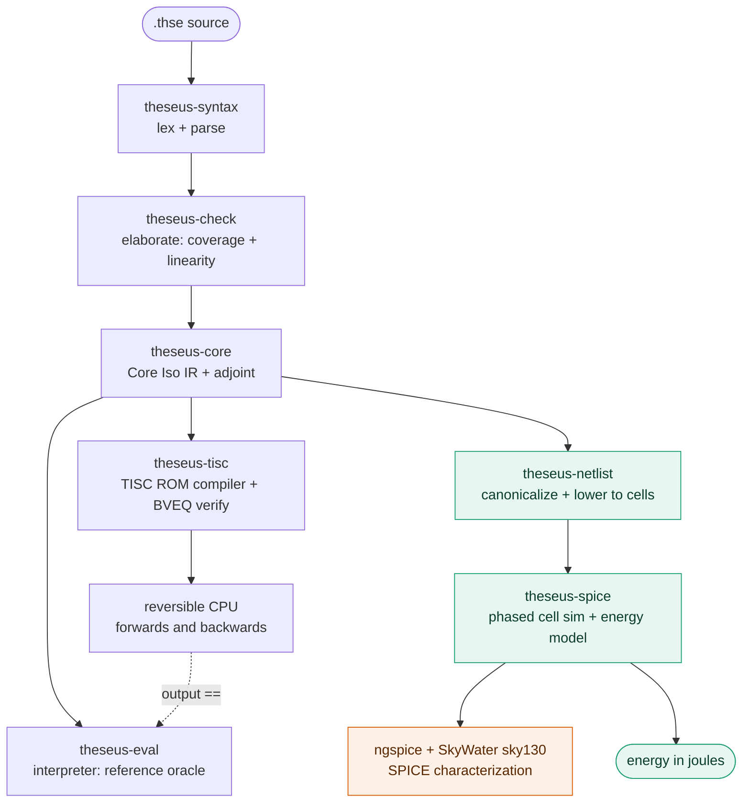
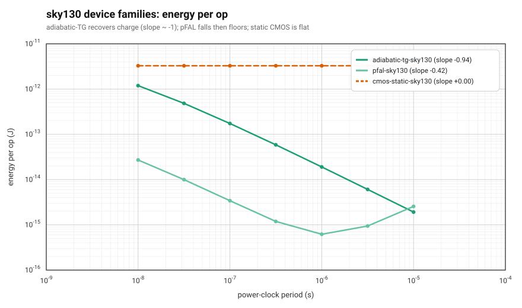
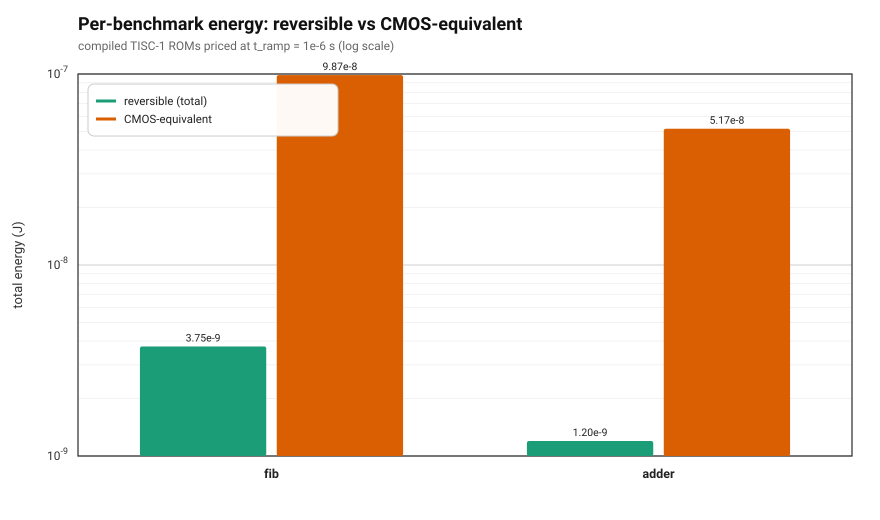

# theseus

theseus is a reversible-computing stack: a small reversible programming
language, a compiler that lowers it to a reversible instruction set, and a
model of an adiabatic (energy-recovering) CPU that runs the result and reports
what it costs in energy. The core correctness properties are proved in Lean.

Every program is a bijection -- it runs forwards and backwards. In the
synthesizable fragment every program is a *total* bijection with a static
worst-case running time, by construction rather than by annotation. That is
what makes programs safe to run on reversible hardware, where information is
never erased and so never has to pay the Landauer energy cost of erasure.

   
  <em>The payoff: as the power clock is slowed, the reversible CPU's energy per
  step falls as ~1/T and slides <strong>below</strong> the flat CMOS
  <code>1/2 CV&sup2;</code> floor that an irreversible design can never beat.</em>

## The pipeline

The whole stack is backed by Lean 4 proofs: reversible by construction, loops
terminate, branches are reversible (see [Proofs](#proofs)).

## Energy: the whole point

Reversible logic never erases information, so it is not bound by the Landauer
floor -- and on an *adiabatic* fabric that recovers the energy it moves, the
dissipation per operation scales as `~1/T` with the power-clock ramp time `T`
(ADR-0028). An irreversible CMOS gate instead pays a flat `1/2 CV^2` every
cycle, no matter how slowly you run it. The plot above is that contrast at the
whole-CPU level, summed over a compiled TISC step's cell inventory -- and it
reproduces **offline**, from the committed rung-0 characterization fits, no
simulator required.

**On real silicon.** The same three-family contrast holds when the cells are
characterized against the real SkyWater **sky130** 130 nm PDK with ngspice:
adiabatic transmission-gate logic recovers charge (log-log slope ~ -0.96),
positive-feedback adiabatic logic falls then floors on leakage, and static CMOS
stays flat.

   
  <em>Energy per operation vs clock period on SkyWater sky130 cells (ngspice).</em>

**On real programs.** Compiled programs inherit the win. Priced at a fixed ramp,
a reversible program's total energy sits far below the CMOS-equivalent gate
count charged at `1/2 CV^2` -- e.g. a byte-wide (U8) Fibonacci ROM, ten
reversible `(a, b) |-> (b, a + b mod 256)` steps each compiling to the
two-word datapath `EXCH ; ADD`, costs well over an order of magnitude less.

   
  <em>Whole-program energy, reversible vs CMOS-equivalent, at a fixed power-clock ramp.</em>

Regenerate every figure with:

    cargo run -p theseus-tisc --example readme_figures     # figs 1 and 3 (offline)
    nix develop .#char --command \
      cargo run -p theseus-tisc --example readme_figures    # adds the sky130 fig (ngspice + PDK)

## The stack

- **Language.** A linearly-typed reversible language: sum and product types,
  reversible isomorphisms, bounded iteration. Comes with a parser, a
  type/coverage checker, and an interpreter.
- **Compiler.** Lowers a program to a reversible cell netlist, and to TISC -- a
  small reversible instruction set -- as a ROM that runs on a simulated
  reversible CPU, forwards and backwards.
- **Energy.** The adiabatic backend models per-step energy, so a compiled
  program is measured in joules, not just checked for correctness.
- **Proofs.** The reversibility and termination guarantees are machine-checked
  in Lean 4 (see [Proofs](#proofs)).

## How to use

Everything runs inside the Nix dev shell, which pins the toolchain:

    nix develop

Build and test the workspace:

    cargo build
    cargo test

Type-check a program:

    cargo run -p theseus-cli -- check conformance/programs/0024-adder.thse
    # ok

Run an isomorphism forwards on a value (logical NOT on a bit):

    cargo run -p theseus-cli -- run conformance/programs/0003-not.thse notb O
    # I

A longer one -- three Fibonacci steps, period 3 mod 2:

    cargo run -p theseus-cli -- run conformance/programs/0023-fib3.thse fib3 "(I, I)"
    # (I, I)

Lower an isomorphism to a reversible netlist and check it against the interpreter:

    cargo run -p theseus-cli -- lower conformance/programs/0026-lfsr.thse lfsrStep
    # inputs: 4 rail pairs
    # outputs: 4 rail pairs
    # oracle: cells agree with eval on 16 inputs

### Working examples

`conformance/programs/` holds small, self-contained programs, each with an
expected-output file. Good ones to read first:

- `0024-adder.thse` -- a reversible half-adder built from gates by composition.
- `0026-lfsr.thse` -- a width-4 LFSR run as a bounded loop (`iter`).
- `0023-fib3.thse` -- a fixed-count Fibonacci iteration.
- `0011-label-loop.thse` -- a data-dependent loop written with labels.

## Proofs

The `theseus-proofs/` Lean 4 project proves the core guarantees:

    nix develop .#proofs
    cd theseus-proofs && lake build

- **Reversibility is a theorem, not an assumption.** Every combinator denotes a
  bijection, and the syntactic adjoint computes its true inverse
  (`Reversibility.lean`).
- **Loops terminate.** A reversible loop over a finite state space exits within
  `|state| + 1` steps (`FiniteTrace.lean`).
- **Branches are reversible.** The come-from branch instruction is its own
  inverse.

The build refuses `sorry`, `native_decide`, or any stray axiom
(`AxiomGuard.lean`), so a green build is a real proof.

## Project layout

| Path | Contents |
|---|---|
| `crates/` | The Rust workspace: syntax, checker, interpreter, netlist, TISC compiler, energy backend, CLI. |
| `theseus-proofs/` | Lean 4 proofs of the core properties. |
| `conformance/` | Language-independent programs with expected outputs. |
| `docs/` | Design docs, decision records (ADRs), the language spec, and the roadmap. |
| `flake.nix` | Nix dev shells and pinned toolchains. |
