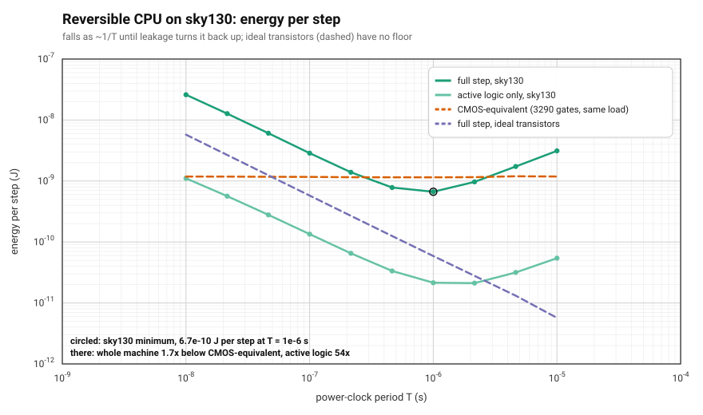
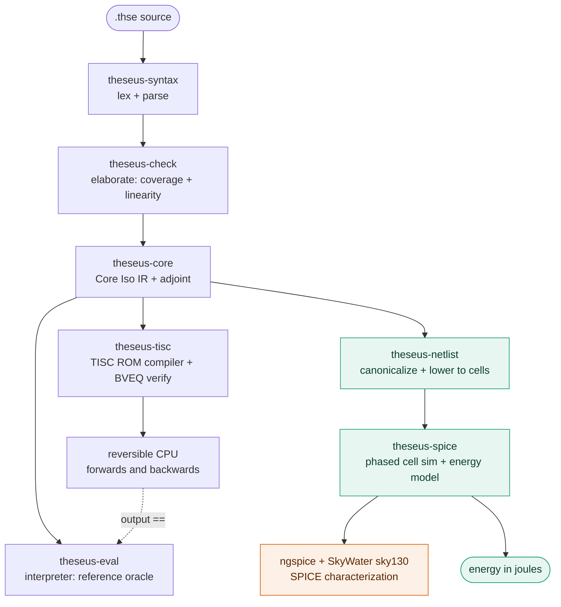
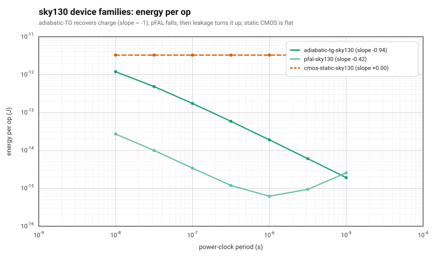
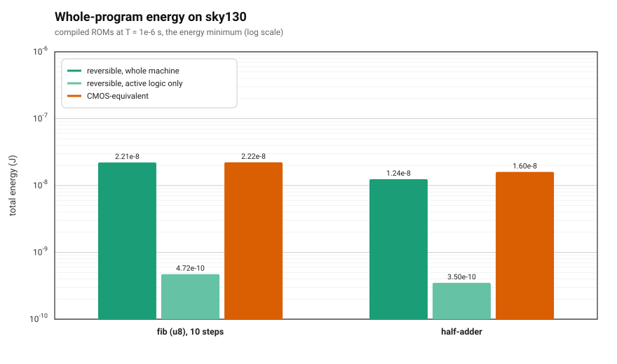

# theseus

theseus is a reversible-computing stack: a small reversible programming
language, a compiler that lowers it to a reversible instruction set, and a
model of an adiabatic (energy-recovering) CPU that runs the result and reports
what it costs in energy. The core correctness properties are proved in Lean.

Every program is a bijection -- it runs forwards and backwards. In the
synthesizable fragment every program is a *total* bijection with a static
worst-case running time, by construction rather than by annotation. That is
what makes programs safe to run on reversible hardware, where information is
never erased and so never has to pay the Landauer energy cost of erasure.

   
  <em>Energy per CPU step on SkyWater sky130 device models. Slowing the power
  clock recovers more of the switching energy, so the step gets cheaper as
  ~1/T -- until leakage, which grows with T, turns the curve back up. At the
  best period (1 &micro;s) the whole machine dissipates <strong>1.7&times;</strong>
  less than the CMOS-equivalent reference; its logic alone,
  <strong>54&times;</strong> less.</em>

## The pipeline

The whole stack is backed by Lean 4 proofs: reversible by construction, loops
terminate, branches are reversible (see [Proofs](#proofs)).

## Energy: the whole point

A static CMOS gate dumps about `C*V^2` of energy every time its output
switches, however slowly it is clocked. It has to: the old value is gone, so
there is nothing left to drive the charge back with. Reversible logic keeps
enough information to undo each step, and on an *adiabatic* fabric -- one that
charges and discharges its wires gradually from a ramped power clock -- that
lets the charge be returned to the supply. The energy lost per operation then
scales as `~1/T` with the clock period `T` (ADR-0028): go slower, lose less.

(These energies are many orders of magnitude above the Landauer limit of
`kT ln 2`. The saving here is recovered switching energy, not a brush with
thermodynamics.)

**The cells are ours; the transistors are sky130's.** The SkyWater sky130
standard-cell libraries are ordinary irreversible CMOS, so theseus has its own
dual-rail transmission-gate cells, built from sky130 *primitive transistors*
and characterized in ngspice (`tt` corner, 1.8 V, 100 fF on every wire). Each
cell is swept over clock periods from 10 ns to 10 &micro;s and the results are
committed as data
([`crates/theseus-spice/data/sky130-chardb.ron`](crates/theseus-spice/data/sky130-chardb.ron)),
so everything below reproduces **offline**. A compiled program's energy is the
sum, over its cell inventory and its step count, of those measurements.

**The reference is like for like.** The irreversible comparison is a static
CMOS gate in the same transistors driving the same 100 fF, measured in the same
database (about 0.35 pJ per cycle), charged once per *active* reversible cell
per executed step. It is a gate-count proxy, not a competing CPU design.

At the best clock period, 1 &micro;s:

| | reversible | CMOS-equivalent | advantage |
|---|---|---|---|
| one CPU step, whole machine | 0.67 nJ | 1.15 nJ | 1.7&times; |
| one CPU step, active logic only | 0.021 nJ | 1.15 nJ | 54&times; |
| `fib` (u8), 10 steps, whole program | 19.2 nJ | 22.2 nJ | 1.16&times; |
| half-adder, whole program | 10.8 nJ | 16.0 nJ | 1.5&times; |

Three things to read off the plot above:

- **The logic wins by 54&times;; the machine by 1.7&times;.** In this fabric
  every wire is re-registered on every clock tick, so signals that reconverge
  must be padded to arrive together. The CPU step has 3,290 active cells and
  about 589,000 of those tick-alignment buffers, which carry about 97% of its
  energy. That overhead, not the logic, is what stands between the two numbers.
- **There is a best speed.** Clocked faster than about 0.3 &micro;s, resistive
  loss dominates and the reference wins. Clocked slower than about
  3 &micro;s, leakage dominates and the reference wins again.
- **The floor is the transistors', not the logic's.** The dashed curve is the
  same machine on ideal transistors with no leakage: it keeps falling as
  `1/T` for as long as you are willing to wait.

**At the cell level** the same contrast shows across three logic families on
sky130: the adiabatic transmission gate recovers charge (log-log slope -0.94
from 10 ns to 10 &micro;s, against -1 for ideal recovery), positive-feedback
adiabatic logic falls and then turns back up, and static CMOS stays flat.

   
  <em>Energy per operation vs clock period for single cells on sky130 (ngspice).
  The transmission gate and the CMOS inverter drive 1 pF; the PFAL gate drives
  100 fF per rail, so compare the shapes, not the heights.</em>

**On real programs** the whole-machine and logic-only energies bracket the
reference the same way. The byte-wide (U8) Fibonacci below is ten reversible
`(a, b) |-> (b, a + b mod 256)` steps, each compiling to the two-word datapath
`EXCH ; ADD`.

   
  <em>Whole-program energy on sky130 at T = 1 &micro;s: the whole reversible
  machine, its active logic alone, and the CMOS-equivalent reference.</em>

**What this is not.** It is a model, not silicon: the power clocks are ideal
sources (no clock-generator or resonator loss), there are no layout parasitics,
and a program's energy is a sum of per-cell measurements, not a SPICE run of the
whole netlist.

Reproduce:

    cargo run --release -p theseus-tisc --example sky130_energy    # the tables behind the figures (offline)
    cargo run --release -p theseus-tisc --example readme_figures   # figs 1 and 3 (offline)
    nix develop .#char --command \
      cargo run --release -p theseus-tisc --example readme_figures   # adds the cell-level fig (ngspice + PDK)
    nix develop .#char --command \
      cargo run --release -p theseus-spice --example characterize_sky130   # re-measure the cells

## The stack

- **Language.** A linearly-typed reversible language: sum and product types,
  reversible isomorphisms, bounded iteration. Comes with a parser, a
  type/coverage checker, and an interpreter.
- **Compiler.** Lowers a program to a reversible cell netlist, and to TISC -- a
  small reversible instruction set -- as a ROM that runs on a simulated
  reversible CPU, forwards and backwards.
- **Energy.** The adiabatic backend models per-step energy, so a compiled
  program is measured in joules, not just checked for correctness.
- **Proofs.** The reversibility and termination guarantees are machine-checked
  in Lean 4 (see [Proofs](#proofs)).

## How to use

Everything runs inside the Nix dev shell, which pins the toolchain:

    nix develop

Build and test the workspace:

    cargo build
    cargo test

Type-check a program:

    cargo run -p theseus-cli -- check conformance/programs/0024-adder.thse
    # ok

Run an isomorphism forwards on a value (logical NOT on a bit):

    cargo run -p theseus-cli -- run conformance/programs/0003-not.thse notb O
    # I

A longer one -- three Fibonacci steps, period 3 mod 2:

    cargo run -p theseus-cli -- run conformance/programs/0023-fib3.thse fib3 "(I, I)"
    # (I, I)

Compile byte-wide Fibonacci to a ROM, run it forwards on the simulated CPU, then
run the same machine backwards from the answer:

    cargo run --release -p theseus-tisc --example fib_round_trip
    # ROM: EXCH ; ADD, three times
    # (13, 21) -> (55, 89) -> (13, 21)

Lower an isomorphism to a reversible netlist and check it against the interpreter:

    cargo run -p theseus-cli -- lower conformance/programs/0026-lfsr.thse lfsrStep
    # inputs: 4 rail pairs
    # outputs: 4 rail pairs
    # oracle: cells agree with eval on 16 inputs

### Working examples

`conformance/programs/` holds small, self-contained programs, each with an
expected-output file. Good ones to read first:

- `0024-adder.thse` -- a reversible half-adder built from gates by composition.
- `0026-lfsr.thse` -- a width-4 LFSR run as a bounded loop (`iter`).
- `0023-fib3.thse` -- a fixed-count Fibonacci iteration.
- `0011-label-loop.thse` -- a data-dependent loop written with labels.

## Proofs

The `theseus-proofs/` Lean 4 project proves the core guarantees:

    nix develop .#proofs
    cd theseus-proofs && lake build

- **Reversibility is a theorem, not an assumption.** Every combinator denotes a
  bijection, and the syntactic adjoint computes its true inverse
  (`Reversibility.lean`).
- **Loops terminate.** A reversible loop over a finite state space exits within
  `|state| + 1` steps (`FiniteTrace.lean`).
- **Branches are reversible.** The come-from branch instruction is its own
  inverse.

The build refuses `sorry`, `native_decide`, or any stray axiom
(`AxiomGuard.lean`), so a green build is a real proof.

## Project layout

| Path | Contents |
|---|---|
| `crates/` | The Rust workspace: syntax, checker, interpreter, netlist, TISC compiler, energy backend, CLI. |
| `theseus-proofs/` | Lean 4 proofs of the core properties. |
| `conformance/` | Language-independent programs with expected outputs. |
| `docs/` | Design docs, decision records (ADRs), the language spec, and the roadmap. |
| `flake.nix` | Nix dev shells and pinned toolchains. |
